<a href="https://frankfu.me">
  <picture>
    <source media="(prefers-color-scheme: dark)" srcset="assets/header-dark.svg">
    
  </picture>
</a>

 

Hi, I'm Frank: a data and business analyst with a UX background, and a cook on the side.

I serve fun, hopefully, meaningful products and Sichuan (Szechwan) cuisine.  
*Both only count if you come back for more...*

### How I cook

`01` &nbsp;**"So what?" comes first.**  
If I can't say why it matters now and who needs it, I don't even open Claude yet.

`02` &nbsp;**I'd rather fix the leak than buy a bigger bucket.**  
Putting AI on top of everything doesn't necessarily make it better. I always go back to first principles: what are we actually trying to do, and is there a better way to do it?

`03` &nbsp;**A number isn't done until it says why.**  
And what someone should do next. If you close a chart and nothing changes, it was decoration.

`04` &nbsp;**Version one is a guess.**  
I ship it, watch what people do with it, and rebuild. Ship, learn, reship... sometimes the right move is to step back and rethink.

### Things I've made

- **Agentic reporting flow** at BioMarin → [case study](https://frankfu.me/works/biomarin)
- **Clinical trial risk model** → [case study](https://frankfu.me/works/clinical-trial-risk)
- **My Brain**, like literally, my digital self with ∞ memory → [live demo](https://frankfu.me/progress?p=brain)
- Plus data pipelines, dashboards, agents, apps, and whatever else gets stuck in my head

> If an idea won't leave, I research it, then build it. There's a whole notebook of things still waiting: some for work, some purely for fun.

**See everything on [frankfu.me →](https://frankfu.me)**

### Now shipping

Every project has a public log of what I changed and why, so you can judge the work for yourself.

**Have a look if you're curious: [frankfu.me/progress →](https://frankfu.me/progress)**

### Toolbox

**Analysis** &nbsp; `SQL` `Python` `R`  
**Data & BI** &nbsp; `Databricks` `Snowflake` `Power BI` `Tableau`  
**AI** &nbsp; `LLM agents` `RAG` `evals`

Basically everything you'd expect on a DA/BA/PM profile. These tools get a lot more interesting once you start mixing your own combinations.

---

Graduating from UCLA Anderson's MS in Business Analytics in **December 2026**, and looking for **full-time data and product roles**.

If you made it this far, you should probably say hi on **[LinkedIn](https://linkedin.com/in/frank-fu-jiajun)** or at **[frankfu1747@gmail.com](mailto:frankfu1747@gmail.com)**.
